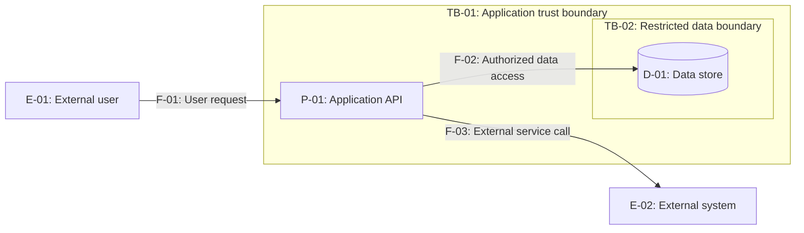

# Threat Model — <system or feature>

**Status:** Proposed / Provisional  
**Review scope and version:** <system, change, branch/commit if supplied>  
**Evidence reviewed:** <C4 / ADR / source paths / configs / requirements>  
**Decision owner(s):** <known or Unassigned>  
**Not inspected / major assumptions:** <explicit limitations>

## 1. System, actors, assets and constraints

| ID | Asset / actor / component | Sensitivity / privilege | Owner or source |
| --- | --- | --- | --- |
| A-01 | <important asset> | <classification or Unknown> | <owner or Unassigned> |

**Primary security requirements:** <authorization, confidentiality, integrity, availability, auditability as evidenced>  
**System boundary and exclusions:** <what is included and excluded>  
**Threat-actor capabilities:** <high-level, evidence-based assumptions; no exploit instructions>

## 2. Data-flow diagram (DFD-like Mermaid)

Use stable element IDs in the actual model. **The example below is illustrative only**; replace or remove all sample entities and flows. Mermaid subgraphs label proposed trust boundaries but **do not prove technical isolation**.

Replace "Authorized data access" with a neutral flow label unless that authorization control is **verified**. Explicitly identify trust crossings in the boundary/flow table rather than relying only on diagram layout.

| Flow ID | From -> to | Data / operation | Trust boundary crossed | Evidence / unknowns |
| --- | --- | --- | --- | --- |
| F-01 | <source -> destination> | <purpose, classification> | TB-01 / None | <path, diagram, assumption> |

## 3. STRIDE threat register

Keep a stable `TH-001` identifier for each distinct scenario; tie findings to actual flows or boundaries. Include only applicable threats.

| ID | STRIDE | Element / flow / TB | Scenario and affected asset | Evidence level / reference | Inherent risk | Existing controls (evidenced?) | Proposed response and control | Residual risk / state | Owner | Confidence | Defensive verification |
| --- | --- | --- | --- | --- | --- | --- | --- | --- | --- | --- | --- |
| TH-001 | <S/T/R/I/D/E> | F-01 / TB-01 | <credible scenario and consequence> | <Hypothesis / Design-supported / Observed weakness / Demonstrated failure; source> | <Critical/High/Medium/Low/Unassessed + reason> | <control + evidence, or Unverified> | <Mitigate/Avoid/Transfer/Accept proposed; concrete measure> | <Provisional/Unassessed or supported rating> | <person/team or Unassigned> | <High/Medium/Low> | <test, review or check; not executed> |

## 4. Priority decisions and open questions

- **Most important threats:** <TH IDs and why>
- **Required approvals / risk acceptance proposals:** <decision owner and justification; never implicitly Accepted>
- **High-impact unknowns:** <missing evidence and smallest useful verification>
- **If applicable:** <privacy/LINDDUN or AI/agent-specific concerns, kept distinct from STRIDE categories>

## 5. Verification, residual risk and maintenance

| Risk / control ID | Defensive validation and expected evidence | Responsible owner | Review trigger |
| --- | --- | --- | --- |
| TH-001 | <specific negative/contract/resilience validation> | <owner or Unassigned> | <architecture change or incident> |

**Residual risk not yet accepted:** <state if unknown>  
**Test execution:** Not performed by this skill.  
**Next review:** <event or approved schedule; no invented date>

This template is a **report**, not authorization to write it into the target repository. Remove irrelevant sections and example entities. Never turn a proposed control into a claim that it is implemented or effective.
